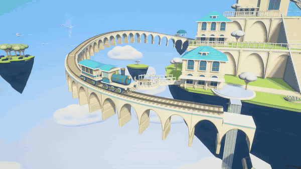

<p align="center">
  
</p>

<h1 align="center">CloudRail · 云上列车</h1>

<p align="center"><strong>Watch a little train travel through the clouds as the railway unfolds ahead.</strong></p>
<p align="center">Floating castles · Unfolding viaducts · Birds in flight · Scenic cameras</p>
<p align="center">A scenic desktop experience built with AI and Unity.</p>

<p align="center">
  <a href="https://github.com/Hao2048/CloudRail/releases/latest">Download for macOS</a> ·
  <a href="#in-game-showcase">Watch the showcase</a> ·
  <a href="#open-the-source">Run the source</a> ·
  <a href="README.md">中文</a>
</p>

<p align="center">
  <a href="https://github.com/Hao2048/CloudRail/releases/latest">
    
  </a>
  <br><sub>A little train, a railway unfolding ahead, and a world above the clouds.</sub>
</p>

## In-game showcase

<p align="center">
  <a href="https://github.com/Hao2048/CloudRail/releases/download/v0.1.0/CloudRail-Showcase-1080p.mp4">
    
  </a>
  <br><sub>Full ~31-second loop · Click for the 1080p video with sound</sub>
</p>

<p align="center">
  <a href="https://github.com/Hao2048/CloudRail/releases/download/v0.1.0/CloudRail-Showcase-1080p.mp4">▶ Watch / download in 1080p</a> ·
  <a href="docs/media/showcase.mp4">Lightweight 720p copy</a>
</p>

All footage is rendered in Unity. The close tracking shot with birds is at **15–23 seconds**.
The animated preview is silent. GitHub's reduced-motion preference may require clicking to play it.

<p align="center">
  
  <br><sub>Sharing the journey with the birds.</sub>
</p>

## Features

- Floating castles, terraced gardens, windmills, waterfalls and scenic landmarks.
- Arched supports, sleepers and rails unfold in staggered motion ahead of the train.
- A 3D route with curves, straights, climbs and descents; moving wheels, rods and steam.
- Flocks appear along selected sections, flapping, gliding and circling near the train.
- Opaque sculpted model clouds and continuous rock detail.
- Scenic cameras plus optional on-foot exploration, star collection and station travel.
- Original synthesized piano/bell music and ambient effects.

## Play on Mac

Download the Universal DMG from [Releases](https://github.com/Hao2048/CloudRail/releases/latest),
open it, and drag **CloudRail.app** into **Applications**. A ZIP and SHA-256
checksums are also available. Requires **macOS 12+**, Apple Silicon or Intel.
No account is required to play.

This build is not Developer ID signed or notarized. If macOS blocks the first
launch, see [Apple's instructions](https://support.apple.com/en-us/102445) and
only proceed after confirming that you trust the source.

<div align="center">
<table>
<tr><th>Action</th><th>Input</th></tr>
<tr><td>Switch scenic camera</td><td><code>C</code></td></tr>
<tr><td>Orbit</td><td>Hold right mouse button and drag</td></tr>
<tr><td>Zoom</td><td>Scroll wheel, or vertical middle-button drag</td></tr>
<tr><td>Pause scenic mode</td><td><code>Space</code></td></tr>
<tr><td>Toggle scenic / exploration modes</td><td><code>Tab</code></td></tr>
<tr><td>Walk in exploration mode</td><td><code>W A S D</code></td></tr>
<tr><td>Interact / board / leave the train</td><td><code>E</code></td></tr>
<tr><td>Choose destination while boarded and stopped</td><td><code>F</code></td></tr>
<tr><td>Exploration help / pause menu</td><td><code>H</code> / <code>Esc</code></td></tr>
</table>
</div>

## Open the source

```sh
git clone https://github.com/Hao2048/CloudRail.git
```

Open the project using **Unity 6.6 / 6000.6.0f1**. Let Unity restore its UPM
packages and import the assets, then open **Assets/Scenes/CloudRail_Visual.unity**
and press Play. The project uses URP 17.6.0, Input System 1.20.0, and uGUI/TextMeshPro.
Generated meshes, materials, fonts, and audio are committed, so a fresh clone does
not require running a scene builder. Other Editor versions have not been verified.

To build, install macOS build support for this Editor and choose
**Cloud Rail → Build macOS Release (Universal)**. The output is
`Builds/macOS/CloudRail.app`; the entry point is
`CloudRail.Editor.CloudRailPlayerBuilder.BuildMac`.

On macOS, run `python3 AgentScripts/package_macos.py` to package a DMG and ZIP,
include font licenses, apply ad-hoc signing to the distribution copy, and write
SHA-256 checksums under `Releases/`.

Runtime code lives in `Assets/CloudRail/Scripts`, procedural builders in
`Assets/CloudRail/Editor`, shaders in `Assets/CloudRail/Shaders`, and synthesized
audio source scripts in `AgentScripts`. See the [Chinese README](README.md) for
the full directory guide and design documents. Earlier milestone scenes remain
as development references; the current scene and build use **CloudRail_Visual**.
Running an early full-scene generator can replace later scene content.

This is a visual prototype in active development. This release supplies a macOS
player; Windows and Linux binaries are not included. Capture helpers compile
only inside the Editor and do not run in ordinary gameplay.

## License

Original code, procedural scene content, and synthesized audio are available under
[MIT](LICENSE). Fonts, imported TextMeshPro content, and Unity components retain
their own licenses; see [third-party notices](THIRD_PARTY_NOTICES.md).
