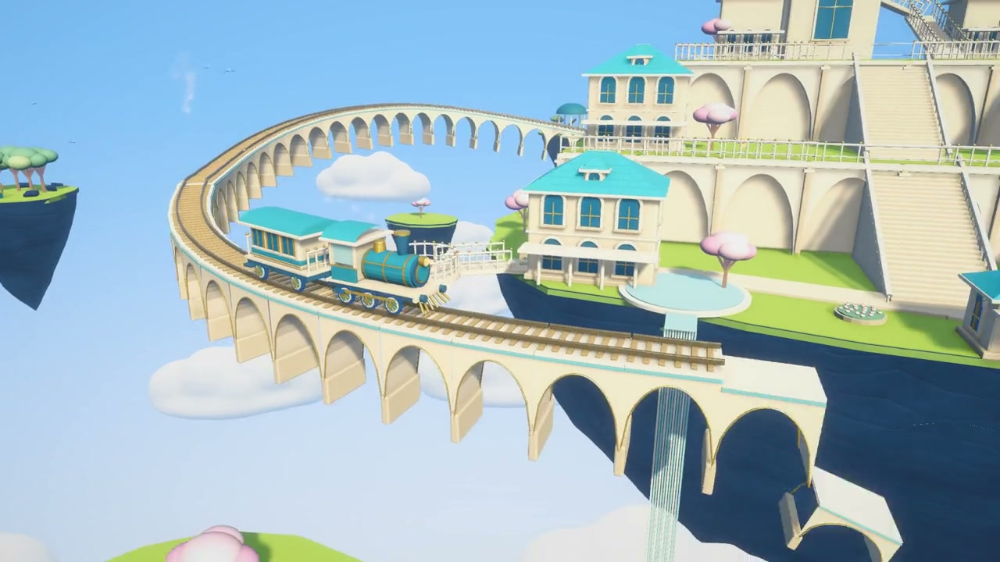

<p align="center">
  
</p>

<h1 align="center">云上列车 · CloudRail</h1>

<p align="center"><strong>看火车越过云海，铁轨在前方一段段展开。</strong></p>
<p align="center">浮空城堡 · 拱桥铁路 · 鸟群伴飞 · 自由观景</p>
<p align="center">一个用 AI 与 Unity 持续打磨的桌面风景体验，邀请你在云端慢下来。</p>

<p align="center">
  <a href="https://github.com/Hao2048/CloudRail/releases/latest">下载 macOS 试玩版</a> ·
  <a href="#实机展示">观看实机展示</a> ·
  <a href="#操作">操作指南</a> ·
  <a href="#用-unity-打开">源码运行</a> ·
  <a href="README.en.md">English</a>
</p>

<p align="center">
  <a href="https://github.com/Hao2048/CloudRail/releases/latest">
    
  </a>
  <br><sub>从一列小火车开始，沿着逐段展开的铁路，穿过云端群岛。</sub>
</p>

## 实机展示

<p align="center">
  <a href="https://hao2048.github.io/CloudRail/">
    
  </a>
  <br><sub>▶ 点击播放约 31 秒 1080p 高清原视频 · 含原声</sub>
</p>

<p align="center">
  <a href="https://hao2048.github.io/CloudRail/">▶ 在线播放 1080p 高清原视频</a>
</p>

以上均为 Unity 实际运行画面。展示片包含列车近景、城堡全景与拉远收尾，**15–23 秒可以看到鸟群在火车旁盘旋伴飞**。点击上方封面即可打开带原声的 1080p 高清原视频。

### 与鸟群一起穿过云端

<p align="center">
  
  <br><sub>沿途出现的鸟群，会围绕列车拍翼、滑翔与转弯跟随。</sub>
</p>

## 画面与体验

- **云端群岛**：层叠城堡、钟塔、花园、风车、瀑布与沿线小景。
- **会展开的铁路**：拱桥基础、枕木和钢轨依次平滑出现，铺向火车前方。
- **有起伏的旅程**：曲线、直线、上坡与下坡组成的三维路线，车轮、连杆与蒸汽持续运动。
- **鸟群伴飞**：在指定路段出现，围绕列车拍翼、滑翔、转弯跟随。
- **模型云与岩壁**：封闭的圆润云团、高低错落的布局、带自然凹凸的岩石表面。
- **自由看风景**：切换机位、环绕和拉近拉远；另有下车探索、星光收集与站点旅行。
- **原创合成声音**：钢琴与钟琴主题、风声、轮轨声、汽笛和瀑布环境声。

## 直接试玩：macOS

到 [Releases](https://github.com/Hao2048/CloudRail/releases/latest) 下载 `CloudRail-v0.1.0-macOS-universal.dmg`，打开后把 **CloudRail.app** 拖到 **Applications**。也提供 ZIP 便携版和 SHA-256 校验文件。

- **系统**：macOS 12 或更新版本。
- **架构**：Apple Silicon 与 Intel，Universal 应用。
- **运行**：本地单机，无需登录。
- 当前包没有 Apple Developer ID 签名或公证。若系统阻止首次打开，请参照 [Apple 的打开方式说明](https://support.apple.com/zh-cn/102445)，在确认来源后通过系统的“隐私与安全性”设置打开。

## 操作

默认进入观景模式。

<div align="center">
<table>
<tr><th>操作</th><th>按键</th></tr>
<tr><td>切换观景机位</td><td><code>C</code></td></tr>
<tr><td>环绕镜头</td><td>按住鼠标右键拖动</td></tr>
<tr><td>调整远近</td><td>鼠标滚轮，或按住中键上下拖动</td></tr>
<tr><td>暂停 / 继续观景</td><td><code>Space</code></td></tr>
<tr><td>切换观景 / 探索</td><td><code>Tab</code></td></tr>
<tr><td>探索时移动</td><td><code>W A S D</code></td></tr>
<tr><td>探索时交互、上下车</td><td><code>E</code></td></tr>
<tr><td>停站且已上车时选择目的地</td><td><code>F</code></td></tr>
<tr><td>探索时帮助 / 暂停菜单</td><td><code>H</code> / <code>Esc</code></td></tr>
</table>
</div>

## 用 Unity 打开

1. 克隆仓库：

   ```sh
   git clone https://github.com/Hao2048/CloudRail.git
   ```

2. 在 Unity Hub 中添加项目目录。使用 **Unity 6.6（6000.6.0f1）**；其他版本尚未逐一验证。
3. 等待 Unity 导入资源并解析 UPM 依赖。项目使用 **URP 17.6.0、Input System 1.20.0、uGUI/TextMeshPro**。
4. 打开 **`Assets/Scenes/CloudRail_Visual.unity`**，点击 Play。

`Library`、`Temp`、`Logs` 和本机配置均不在仓库中，首次导入会重新生成。当前展示场景及生成的网格、材质、字体和音频已提交，无需重新生成模型。

### 自己构建 Mac 应用

在 Unity Hub 安装对应 Editor 的 macOS 构建模块。退出 Play，点击菜单 **Cloud Rail → Build macOS Release (Universal)**。

构建入口：`CloudRail.Editor.CloudRailPlayerBuilder.BuildMac`。输出 `Builds/macOS/CloudRail.app`，构建摘要位于 `Builds/Reports/macOS-build.json`。它始终使用当前的 `CloudRail_Visual` 场景。

需要制作 DMG / ZIP 时，在 Mac 上运行 `python3 AgentScripts/package_macos.py`。脚本会附带字体协议、对分发副本做本地签名，并在 `Releases/` 输出安装包和 SHA-256 校验文件。

## 项目结构

<div align="center">
<table>
<tr><th>目录</th><th>内容</th></tr>
<tr><td><code>Assets/Scenes/CloudRail_Visual.unity</code></td><td>当前完整展示场景</td></tr>
<tr><td><code>Assets/CloudRail/Scripts/</code></td><td>火车、路径、展开铁路、镜头、鸟群与探索逻辑</td></tr>
<tr><td><code>Assets/CloudRail/Editor/</code></td><td>程序化建模、场景工具与 macOS 构建入口</td></tr>
<tr><td><code>Assets/CloudRail/Generated/</code></td><td>已生成的模型、材质、渲染配置及早期阶段资源</td></tr>
<tr><td><code>Assets/CloudRail/Shaders/</code></td><td>岩壁、模型云、水流与场景材质</td></tr>
<tr><td><code>Assets/CloudRail/Audio/</code></td><td>项目合成的音乐与环境音</td></tr>
<tr><td><code>AgentScripts/</code></td><td>音频合成脚本及开发辅助脚本</td></tr>
<tr><td><code>Documentation/</code></td><td>设计文档与开发记录；早期里程碑说明仅作历史参考</td></tr>
<tr><td><code>docs/media/</code></td><td>游戏图标、开场画面、展示封面与鸟群动图</td></tr>
</table>
</div>

`CloudRail_Milestone01`、`CloudRail_Journey`、`CloudRail_Release` 是保留的早期阶段场景。**试玩、录像和当前构建均以 `CloudRail_Visual` 为准。** 不建议直接对该场景执行早期的全量生成菜单，这会重建场景内容。

## 开发说明

这是持续打磨的视觉体验原型，当前发行的是桌面 macOS 试玩包。源代码中的桌面输入可供进一步适配其他桌面平台；本次没有发布 Windows / Linux 二进制。

`CloudRailShowcaseCapture.cs` 仅在 Unity Editor 中编译，用于临时录制实机镜头，不进入正式播放器。普通运行不会启动自动录制或诊断流程。

## 开源协议

原创代码、程序化场景内容和合成音频使用 [MIT License](LICENSE)。字体、TextMeshPro 导入内容和 Unity 组件保留各自协议，详见 [第三方声明](THIRD_PARTY_NOTICES.md)。
